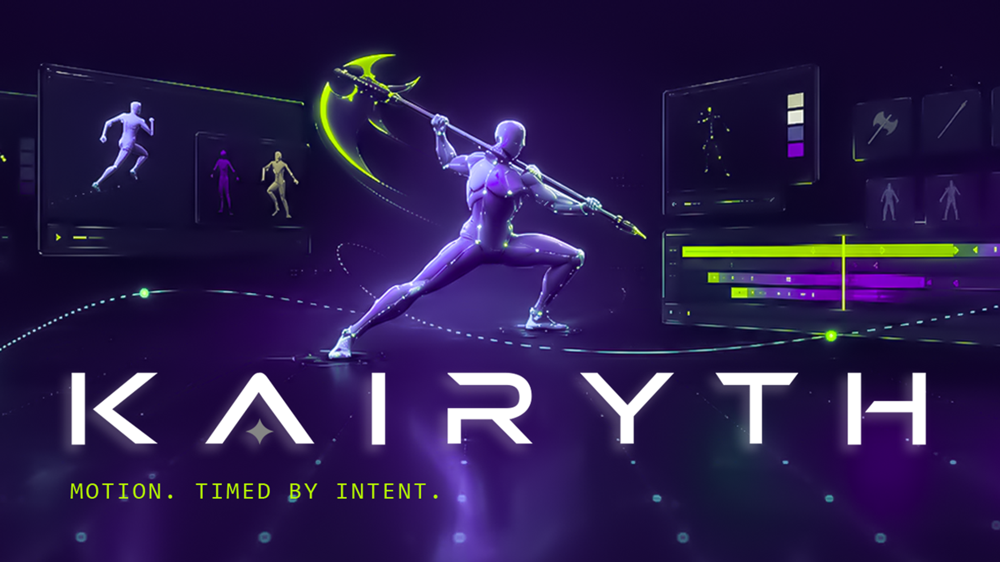
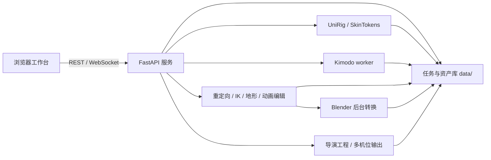

# KAIRYTH V2

[中文](README.md) | [English](README_EN.md)



[▶ 观看宣传视频（YouTube）](https://youtu.be/HiZR8GwEjxE?si=PPxIKmtAUMYT0aU3)

**Motion, timed by intent.**

Kairyth 是本机运行的角色动画与镜头导演工作台，提供资产管理、角色绑定与蒙皮、IK、动作重定向、非破坏动画编辑、地形与步态处理、最终时间轴和多机位导演。界面支持中文和英文，可通过脚本启动和关闭本机服务。

## 当前功能

- 模型、姿势、动作、地形和导演工程资产库。
- UniRig 骨架推理、SOMA-30 对齐、SkinTokens 蒙皮，以及 Two-Bone / 全身 IK。
- 已有姿势的导入、预览、编辑，以及从已有动作提取姿势。
- NVIDIA Kimodo 文本动作生成、航迹控制、临时姿势编辑和场景参照。
- 动作重定向、加法叠加、独立速率、步态贴地、脚锁和 VirtualRoot 处理。
- 非破坏时间轴、根运动与骨骼/IK 编辑、场景组件和过渡。
- 多角色、多摄像机、Camera Cut、黑幕、相机关键帧、构图辅助与导演导出。
- Blender 后台 FBX 导入、验证和导出。

HybrIK 图片新推理和 GVHMR 视频新推理尚未开放，均为实验性功能；兼容包计划后续提供，本版不包含这些兼容包。已有姿势与动作资产的编辑功能不受影响。

AI 生成功能需要各自的模型、环境和使用许可；Blender 负责 FBX 转换。基础编辑界面可以在未安装 AI 模型时启动。功能依赖见 [资源就绪指南](docs/RESOURCE_READINESS.md)。

## 架构

浏览器通过同源 REST API / WebSocket 访问本机 FastAPI 服务。服务管理资产与任务，将耗时的绑定、生成或格式转换交给独立进程；编辑运算使用 NumPy / SciPy，资产保存在项目内 `data/`。



| 模块 | 数据流与实现 | 主要入口 |
| --- | --- | --- |
| 工作台与中英文界面 | HTML / CSS / JavaScript / Three.js；客户端状态、资产预览和 API 调用 | [`server.py`](motionbuilder_app/server.py)、[`index.html`](motionbuilder_app/static/index.html)、[`studio.js`](motionbuilder_app/static/studio.js)、[`studio_i18n.js`](motionbuilder_app/static/studio_i18n.js) |
| 模型与角色库 | 导入静态网格；保存绑定角色、预览和导出结果 | [`stores.py`](motionbuilder_app/stores.py)、[`assets.py`](motionbuilder_app/assets.py)、[`blender_import_mesh.py`](motionbuilder_app/blender_import_mesh.py) |
| 绑定与蒙皮 | 网格对齐 → UniRig 骨架 → SOMA-30 拟合/关节确认 → SkinTokens 权重 → 绑定包 | [`session.py`](motionbuilder_app/meshpreps/session.py)、[`bind_pipeline.py`](motionbuilder_app/meshpreps/bind_pipeline.py)、[`soma_fit.py`](motionbuilder_app/rigging/soma_fit.py)、[`soma_binding.py`](motionbuilder_app/meshpreps/soma_binding.py) |
| 姿势与动作资产 | 姿势导入/编辑、已有动作预览、姿势提取及分层资产存储 | [`pose_store.py`](motionbuilder_app/pose_store.py)、[`stores.py`](motionbuilder_app/stores.py)、[`library_stores.py`](motionbuilder_app/library_stores.py) |
| Kimodo 创作 | 提示词、航迹与姿势约束 → 可取消 worker → SOMA-30 动作包 | [`kimodo_store.py`](motionbuilder_app/kimodo_store.py)、[`kimodo_worker.py`](motionbuilder_app/kimodo_worker.py)、[`kimodo_runtime.py`](motionbuilder_app/kimodo_runtime.py)、[`kimodo_authoring.js`](motionbuilder_app/static/kimodo_authoring.js) |
| 重定向与 IK | 源动作、目标骨架及关节映射 → 烘焙世界变换；Two-Bone / 全身 IK | [`retarget.py`](motionbuilder_app/retarget.py)、[`soma_retarget_profile.py`](motionbuilder_app/rigging/soma_retarget_profile.py)、[`ik/`](motionbuilder_app/ik/) |
| 地形与步态 | 高度场采样、脚底目标、骨盆补偿、脚锁和滑步修正；输出新动画 | [`gait_ik_v2.py`](motionbuilder_app/gait_ik_v2.py)、[`gait_store.py`](motionbuilder_app/gait_store.py)、[`foot_lock.py`](motionbuilder_app/foot_lock.py)、[`terrain_store.py`](motionbuilder_app/terrain_store.py)、[`terrain_surface.py`](motionbuilder_app/terrain_surface.py) |
| 叠加与最终时间轴 | 不同长度/速率的加法动画；片段裁切、变速、场景、过渡、根运动和骨骼/IK 编辑 | [`additive.py`](motionbuilder_app/additive.py)、[`additive_store.py`](motionbuilder_app/additive_store.py)、[`library_stores.py`](motionbuilder_app/library_stores.py)、[`ik_constraints.py`](motionbuilder_app/ik_constraints.py)、[`final_scene_tools.js`](motionbuilder_app/static/final_scene_tools.js) |
| 导演与输出 | 多角色布景、相机轨道、Camera Cut、缩略图、视频/截图、控制图及可恢复参考包 | [`director_store.py`](motionbuilder_app/director_store.py)、[`director_studio.js`](motionbuilder_app/static/director_studio.js)、[`director_studio.css`](motionbuilder_app/static/director_studio.css) |
| FBX 与服务生命周期 | 后台 Blender 转换/验证；本机服务启动、任务取消及关闭 | [`exporter.py`](motionbuilder_app/exporter.py)、[`blender_export_fbx.py`](motionbuilder_app/blender_export_fbx.py)、[`blender_validate_fbx.py`](motionbuilder_app/blender_validate_fbx.py)、[`start_motionbuilder.ps1`](start_motionbuilder.ps1)、[`stop_motionbuilder.ps1`](stop_motionbuilder.ps1) |

模块间通过 NumPy `.npz` 包传递网格、骨架、绑定矩阵、蒙皮权重与逐帧变换。预览接口分离 scene 元数据和 frames，长动作按段读取。生成和编辑结果先进入任务或预览层，确认后保存为新资产。

典型工作流：

1. 导入角色网格 → 对齐和绑定 → 确认骨架与蒙皮 → 保存角色。
2. 导入已有动作或用 Kimodo 生成动作 → 重定向 → IK / 贴地 / 脚锁 → 保存新动画。
3. 编排动画片段 → 调整过渡、根运动和骨骼/IK 轨 → 编译并导出 FBX。
4. 布置角色与场景 → 设置相机、关键帧和 Camera Cut → 导演预览与输出。

## 部署与启动

基础环境：Windows 10/11 x64、PowerShell 5.1/7、Python 3.10 x64、支持 WebGL2 的浏览器。UniRig / SkinTokens 使用独立 Python 3.11 环境；GPU 扩展必须匹配 Python、PyTorch、CUDA 和驱动版本。

```powershell
git clone https://github.com/Xav13RRR/Kairyth-V2-Public.git
Set-Location .\Kairyth-V2-Public
Set-ExecutionPolicy -Scope Process Bypass
.\install.ps1
.\start_motionbuilder.ps1
```

默认地址：<http://127.0.0.1:7861>。端口被占用时可用 `.\start_motionbuilder.ps1 -Port 7862`。关闭时运行 `.\stop_motionbuilder.ps1`；也可使用“启动MotionBuilder.bat”和“关闭MotionBuilder.bat”。

安装器创建项目内基础环境，并在缺少时下载官方 Blender 4.5.11 LTS 便携版。可用 `-PythonExe 'C:\Path\To\python.exe'` 选择 Python，或 `-SkipBlender` 先安装基础服务。AI 环境和模型按 [中文部署指南](docs/DEPLOYMENT.md) / [English deployment](docs/DEPLOYMENT_EN.md) 单独配置。

## 数据与安全

资产、上传、任务记录和导演工程保存在本地 `data/`；环境在 `runtime/` 与 `third_party/envs/`。升级前单独备份数据，不要将这些目录、模型缓存或凭据提交到源码仓库。

服务仅面向本机单用户，不提供公网用户认证。只导入可信文件，不要把 API 或编码器端口直接暴露到互联网。使用交互式 Hugging Face 登录，不要将令牌放入脚本、截图或 issue。详见 [安全说明](SECURITY.md)。

## 开发检查

```powershell
$py = '.\runtime\python\Scripts\python.exe'
& $py -m pip install -r requirements-dev.txt
& $py -m pytest -q tests --ignore=tests/test_v2_detection_pipeline.py --ignore=tests/test_v2_wsl_cancel.py
node tests/check_studio_i18n.mjs
& $py scripts/check_publication.py --history
& $py scripts/check_publication.py --profile public-workbench --history
```

合成测试不替代模型效果、硬件兼容性或完整 GPU 工作流验证。研究/检测实现不随此源码提供，相应研究集成检查为不适用。

## 许可与来源

工作台兼容组合按 GPLv3 提供，保留上游已有的 or-later 权利；维护者原创的 Kairyth / MKA 贡献另提供 Apache-2.0 授权。第三方代码、模型、字体和资产保留各自条款，根代码许可证不授予这些资源的额外权利。

[授权范围](LICENSE_SCOPE.md) · [第三方说明](THIRD_PARTY_NOTICES.md) · [源码来源](docs/SOURCE_PROVENANCE.md) · [资源与许可清单](docs/resource-license-evidence.json)
