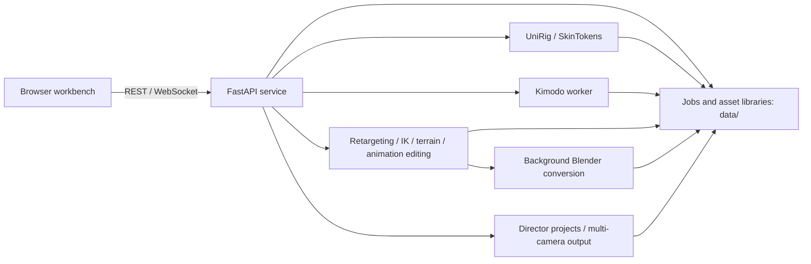

# KAIRYTH V2

[中文](README.md) | [English](README_EN.md)


[▶ Watch the promo video (YouTube)](https://youtu.be/HiZR8GwEjxE?si=PPxIKmtAUMYT0aU3)

**Motion, timed by intent.**

Kairyth is a locally hosted character-animation and shot-direction workbench for asset management, rigging and skinning, IK, motion retargeting, non-destructive animation editing, terrain and gait processing, final timeline assembly, and multi-camera direction. The interface supports Chinese and English, with scripts to start and stop the local service.

## Current features

- Model, pose, motion, terrain and director-project libraries.
- UniRig skeleton inference, SOMA-30 fitting, SkinTokens skinning, and Two-Bone / full-body IK.
- Existing-pose import, preview and editing, including pose extraction from existing motions.
- NVIDIA Kimodo text-to-motion generation, trajectory control, transient pose editing and scene references.
- Retargeting, additive animation, independent playback rates, grounded gait, foot locking and VirtualRoot processing.
- Non-destructive timelines, root-motion and bone/IK editing, scene components and transitions.
- Multiple characters and cameras, Camera Cuts, blackouts, camera keys, framing aids and director export.
- Background Blender FBX import, validation and export.

New HybrIK image inference and GVHMR video inference are experimental and unavailable. Compatibility packages are planned for a future update and are not included in this version. Editing existing pose and motion assets remains available.

AI generation requires the corresponding models, environments and usage permissions; FBX conversion requires Blender. The base editing interface can start without AI models. See [resource readiness](docs/RESOURCE_READINESS.md) for feature dependencies.

## Architecture

The browser communicates with a local FastAPI service through same-origin REST APIs and WebSockets. The service manages assets and jobs, delegates rigging, generation and format conversion to separate processes, and uses NumPy / SciPy for editing operations. Assets are stored under the project's `data/` directory.



| Module | Data flow and implementation | Main entry points |
| --- | --- | --- |
| Workbench and languages | HTML / CSS / JavaScript / Three.js; client state, previews and API calls | [`server.py`](motionbuilder_app/server.py), [`index.html`](motionbuilder_app/static/index.html), [`studio.js`](motionbuilder_app/static/studio.js), [`studio_i18n.js`](motionbuilder_app/static/studio_i18n.js) |
| Model and character libraries | Import static meshes; store rigged characters, previews and exports | [`stores.py`](motionbuilder_app/stores.py), [`assets.py`](motionbuilder_app/assets.py), [`blender_import_mesh.py`](motionbuilder_app/blender_import_mesh.py) |
| Rigging and skinning | Mesh alignment → UniRig skeleton → SOMA-30 fitting/joint confirmation → SkinTokens weights → binding bundle | [`session.py`](motionbuilder_app/meshpreps/session.py), [`bind_pipeline.py`](motionbuilder_app/meshpreps/bind_pipeline.py), [`soma_fit.py`](motionbuilder_app/rigging/soma_fit.py), [`soma_binding.py`](motionbuilder_app/meshpreps/soma_binding.py) |
| Pose and motion assets | Pose import/editing, existing-motion preview, pose extraction and layered asset storage | [`pose_store.py`](motionbuilder_app/pose_store.py), [`stores.py`](motionbuilder_app/stores.py), [`library_stores.py`](motionbuilder_app/library_stores.py) |
| Kimodo authoring | Prompts, trajectories and pose constraints → cancellable worker → SOMA-30 motion bundle | [`kimodo_store.py`](motionbuilder_app/kimodo_store.py), [`kimodo_worker.py`](motionbuilder_app/kimodo_worker.py), [`kimodo_runtime.py`](motionbuilder_app/kimodo_runtime.py), [`kimodo_authoring.js`](motionbuilder_app/static/kimodo_authoring.js) |
| Retargeting and IK | Source motion, target rig and joint mapping → baked world transforms; Two-Bone / full-body IK | [`retarget.py`](motionbuilder_app/retarget.py), [`soma_retarget_profile.py`](motionbuilder_app/rigging/soma_retarget_profile.py), [`ik/`](motionbuilder_app/ik/) |
| Terrain and gait | Heightfield sampling, foot targets, pelvis compensation, foot locking and sliding correction; saved as new animation | [`gait_ik_v2.py`](motionbuilder_app/gait_ik_v2.py), [`gait_store.py`](motionbuilder_app/gait_store.py), [`foot_lock.py`](motionbuilder_app/foot_lock.py), [`terrain_store.py`](motionbuilder_app/terrain_store.py), [`terrain_surface.py`](motionbuilder_app/terrain_surface.py) |
| Additive and final timelines | Unequal-length/rate additive motions; trimming, speed, scene components, transitions, root motion and bone/IK tracks | [`additive.py`](motionbuilder_app/additive.py), [`additive_store.py`](motionbuilder_app/additive_store.py), [`library_stores.py`](motionbuilder_app/library_stores.py), [`ik_constraints.py`](motionbuilder_app/ik_constraints.py), [`final_scene_tools.js`](motionbuilder_app/static/final_scene_tools.js) |
| Direction and output | Characters, camera tracks, Camera Cuts, thumbnails, video/screenshots, control passes and recoverable reference bundles | [`director_store.py`](motionbuilder_app/director_store.py), [`director_studio.js`](motionbuilder_app/static/director_studio.js), [`director_studio.css`](motionbuilder_app/static/director_studio.css) |
| FBX and service lifecycle | Background Blender conversion/validation; local startup, job cancellation and shutdown | [`exporter.py`](motionbuilder_app/exporter.py), [`blender_export_fbx.py`](motionbuilder_app/blender_export_fbx.py), [`blender_validate_fbx.py`](motionbuilder_app/blender_validate_fbx.py), [`start_motionbuilder.ps1`](start_motionbuilder.ps1), [`stop_motionbuilder.ps1`](stop_motionbuilder.ps1) |

NumPy `.npz` bundles carry meshes, skeletons, bind matrices, skinning weights and per-frame transforms between modules. Preview APIs separate scene metadata from frame data and fetch long motions in chunks. Generated and edited output first enters a job or preview layer, then becomes a new asset when the user confirms it.

Typical workflows:

1. Import a character mesh → align and rig → confirm skeleton and skinning → save the character.
2. Import an existing motion or generate one with Kimodo → retarget → apply IK / grounding / foot locks → save a new animation.
3. Arrange clips → adjust transitions, root motion and bone/IK tracks → compile and export FBX.
4. Arrange characters and scenery → set cameras, keys and Camera Cuts → preview and export the directed scene.

## Installation and startup

Base requirements: Windows 10/11 x64, PowerShell 5.1/7, Python 3.10 x64 and a WebGL2 browser. UniRig / SkinTokens use separate Python 3.11 environments; GPU extensions must match Python, PyTorch, CUDA and driver versions.

```powershell
git clone https://github.com/Xav13RRR/Kairyth-V2-Public.git
Set-Location .\Kairyth-V2-Public
Set-ExecutionPolicy -Scope Process Bypass
.\install.ps1
.\start_motionbuilder.ps1
```

Default address: <http://127.0.0.1:7861>. If that port is occupied, use `.\start_motionbuilder.ps1 -Port 7862`. Stop with `.\stop_motionbuilder.ps1`; the supplied start/stop batch files are alternatives.

The installer creates the project's base environment and downloads official Blender 4.5.11 LTS portable when absent. Use `-PythonExe 'C:\Path\To\python.exe'` to select Python or `-SkipBlender` to install the base service first. Configure AI environments and models separately using the [English deployment guide](docs/DEPLOYMENT_EN.md) / [中文部署指南](docs/DEPLOYMENT.md).

## Data and security

Assets, uploads, job records and director projects remain in local `data/`; environments live under `runtime/` and `third_party/envs/`. Back up data separately before upgrades. Do not commit these directories, model caches or credentials to the source repository.

The service is for local single-user use and has no public multi-user authentication. Import trusted files only; do not expose API or encoder ports directly to the Internet. Authenticate with Hugging Face interactively and never place tokens in scripts, screenshots or issues. See [security guidance](SECURITY.md).

## Development checks

```powershell
$py = '.\runtime\python\Scripts\python.exe'
& $py -m pip install -r requirements-dev.txt
& $py -m pytest -q tests --ignore=tests/test_v2_detection_pipeline.py --ignore=tests/test_v2_wsl_cancel.py
node tests/check_studio_i18n.mjs
& $py scripts/check_publication.py --history
& $py scripts/check_publication.py --profile public-workbench --history
```

Synthetic tests do not replace model-quality, hardware-compatibility or complete GPU-workflow validation. Research/detector implementations are not included, so their research-integration checks are not applicable to this source package.

## Licensing and sources

The compatible workbench combination is offered under GPLv3, preserving existing upstream or-later rights. Maintainer-original Kairyth / MKA contributions are additionally offered under Apache-2.0. Third-party software, models, fonts and assets retain their own terms; the root code licenses do not grant additional rights to those resources.

[Licensing scope](LICENSE_SCOPE.md) · [Third-party notices](THIRD_PARTY_NOTICES.md) · [Source provenance](docs/SOURCE_PROVENANCE.md) · [Resource and license inventory](docs/resource-license-evidence.json)
